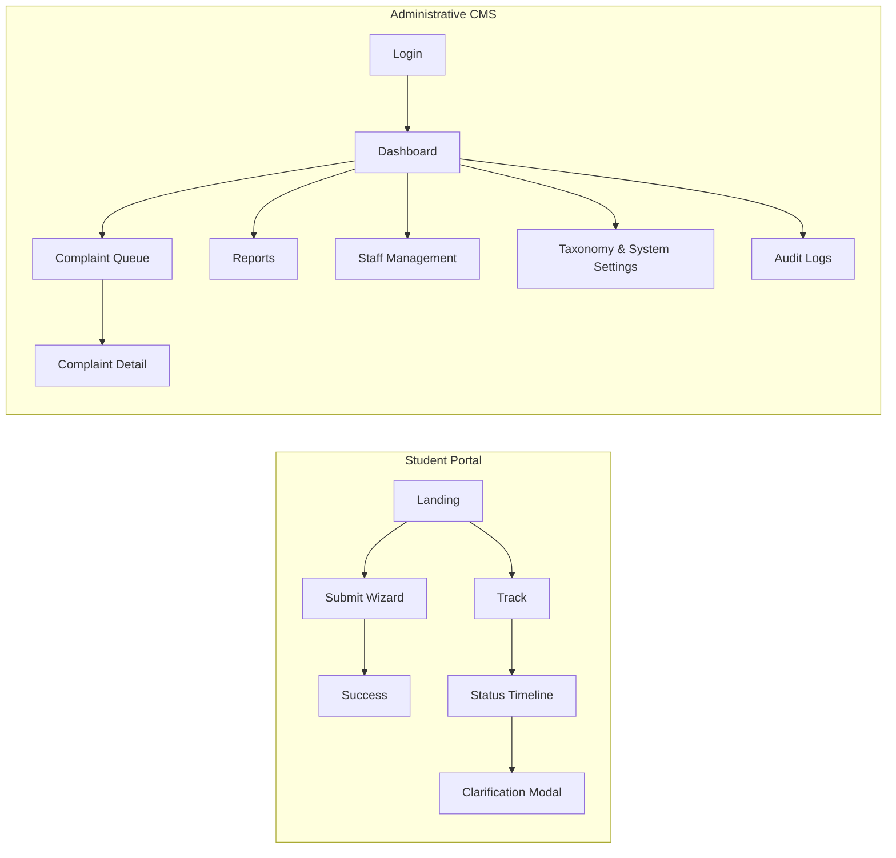

# Design System – Unity Student Support

**Project:** Unity Student Support (Student Complaint & Feedback Management Platform)  
**Document Version:** 1.0.0  
**Status:** Design System Baseline  
**Author:** Principal Product Designer & UX Architect  

---

## 1. Visual Language & Brand Palette

| Token | Value | Usage |
|---|---|---|
| `--color-primary` | `#0F2C59` (Restrained Navy) | Primary UI elements – header, primary buttons, links, active navigation tabs. |
| `--color-primary-dark` | `#091F3C` | Hover/focus state for primary interactions. |
| `--color-accent` | `#0D9488` (Controlled Teal) | Accent for secondary actions, focus outlines, status badges (e.g., **New**, **Urgent**). |
| `--color-accent-light` | `#14B8A6` | Hover/focus for accent elements. |
| `--color-surface` | `#FFFFFF` | Main page backgrounds, card surfaces. |
| `--color-surface-alt` | `#F9FAFB` (very light gray) | Secondary backgrounds (e.g., sidebar, footer). |
| `--color-border` | `#E5E7EB` (light neutral) | Subtle dividers, input outlines. |
| `--color-text-primary` | `#1F2937` (dark gray) | Body copy, headings, labels. |
| `--color-text-muted` | `#6B7280` | Placeholder text, auxiliary information. |
| `--color-success` | `#10B981` | Positive status (e.g., **Resolved**). |
| `--color-warning` | `#F59E0B` | Warning state (e.g., **Approaching SLA breach**). |
| `--color-danger` | `#EF4444` | Error state (e.g., **Failed submission**). |
| `--color-info` | `#3B82F6` | Informational notices. |

### 1.1 Contrast & Accessibility
- All text on `--color-surface` meets WCAG AA contrast ratio (≥ 4.5:1). 
- Accent colors on navy backgrounds meet AA for larger text, AA for normal text with **bold** usage. 
- Focus outlines use a **4 px** solid `--color-accent` ring.

---

## 2. Typography

| Token | Font Family | Size | Line‑Height | Weight | Usage |
|---|---|---|---|---|---|
| `--font-family-base` | "Inter", system-ui, sans-serif | – | – | – | Body copy |
| `--text-xs` | 0.75rem (12 px) | 1.25rem | 400 | Helper text, placeholder |
| `--text-sm` | 0.875rem (14 px) | 1.375rem | 400 | Form labels, secondary content |
| `--text-base` | 1rem (16 px) | 1.5rem | 400 | Primary paragraph, button text |
| `--text-lg` | 1.125rem (18 px) | 1.75rem | 500 | Section headings |
| `--text-xl` | 1.25rem (20 px) | 1.875rem | 600 | Page titles |
| `--text-2xl` | 1.5rem (24 px) | 2rem | 700 | High‑level headings (e.g., landing page headline) |

**Responsive scaling:** On screens `< 640px` (mobile), all `--text-base` and larger increase by **10 %** for readability.

---

## 3. Layout & Spacing System

| Token | Value (px) | Description |
|---|---|---|
| `--spacing-0` | 0 |
| `--spacing-1` | 4 |
| `--spacing-2` | 8 |
| `--spacing-3` | 12 |
| `--spacing-4` | 16 |
| `--spacing-5` | 24 |
| `--spacing-6` | 32 |
| `--spacing-8` | 48 |
| `--spacing-10` | 64 |
| `--spacing-12` | 80 |

- **Grid:** 12‑column fluid grid. Gutters use `--spacing-4` (16 px). 
- **Containers:** Max‑width `1152px` centered with `margin: 0 auto`. 
- **Mobile Breakpoints:** `sm` ≥ 640 px, `md` ≥ 768 px, `lg` ≥ 1024 px, `xl` ≥ 1280 px.

---

## 4. Component Inventory (shadcn/ui based)

| Component | Description | Props (key) | Variants |
|---|---|---|---|
| **Button** | Primary/secondary call‑to‑action. | `variant` (`primary`/`secondary`/`danger`), `size` (`sm`/`md`/`lg`), `disabled` | Rounded corners `0.5rem`, focus ring `--color-accent`. |
| **Card** | Surface container with optional header/footer. | `title`, `subtitle`, `bordered` (bool) | Elevated (shadow `0 1px 3px rgba(0,0,0,0.1)`), flat (border only). |
| **Badge** | Status indicator (e.g., New, Under Review). | `status` (`new`, `in-progress`, `resolved`, `closed`, `urgent`) | Color mapping to `--color-success`, `--color-warning`, `--color-danger`. |
| **FormInput** | Text input with label, error message, optional icon. | `type`, `label`, `placeholder`, `error`, `required` | Standard, read‑only, disabled. |
| **Select** | Dropdown for campus/faculty/department/category. | `options`, `label`, `placeholder`, `error`, `required` | Searchable (type‑ahead) enabled on desktop, native select on mobile. |
| **FileUploader** | Drag‑and‑drop / button for up to 3 files. | `maxFiles`, `maxSizeMB`, `accept` (`pdf,image/*`), `error` | Shows thumbnail preview for images, generic icon for PDFs. |
| **TimelineItem** | Entry in the public tracking timeline. | `date`, `type` (`status`, `response`, `clarification`), `content`, `isPublic` | Light border left‑accent, optional icon. |
| **Modal** | Centered dialog for assignments, escalations, confirmation. | `title`, `children`, `onClose`, `size` (`sm`/`md`/`lg`) | Dismissible via Escape, overlay dim `rgba(0,0,0,0.4)`. |
| **SidebarNav** | Administrative navigation panel. | `items` (array `{label, href, icon, roleVisibility}`) | Collapsible on mobile (`< md`). |
| **Header** | Top bar with brand logo, optional user avatar dropdown. | `showBackButton` (bool) | Fixed sticky, transparent on public pages, solid on admin. |
| **Toast** | Transient feedback (success/error). | `type` (`success`/`error`/`info`), `message`, `duration` | Auto‑dismiss after 5 s, screen‑reader `role=alert`. |
| **Spinner** | Loading indicator. | `size` (`sm`/`md`/`lg`) | Inline or overlay. |
| **EmptyState** | UI shown when a list has no items. | `title`, `description`, `actionLabel`, `onAction` | Uses neutral illustration (fictional). |
| **ErrorPage** | 403 / 404 / 500 generic page. | `code`, `title`, `description`, `actionLabel`, `onAction` | Full‑screen, centered. |

All components are built as **React Server Components** where possible, with client‑side interactivity isolated to a minimal `use client` wrapper.

---

## 5. Screen Inventory (Student Portal)

| # | Screen | Core Purpose | Primary Components |
|---|---|---|---|
| 1 | **Landing Page** (`/`) | Introduce platform, explain confidentiality, CTA to submit complaint. | Header, Hero Card, Feature List (icons + short text), Primary Button ("Submit Complaint"), Footer. |
| 2 | **Complaint Submission – Step 1** (`/portal/submit/step-1`) | Choose privacy mode (Identified / Confidential / Anonymous). | Card group with radio buttons, explanatory callout, Next button. |
| 3 | **Complaint Submission – Step 2** (`/portal/submit/step-2`) | Select Campus, Faculty, Department, Category. | FormInput (Campus), Select (Faculty), Select (Department), Select (Category), Next/Back. |
| 4 | **Complaint Submission – Step 3** (`/portal/submit/step-3`) | Provide subject, incident date, accused party (optional). | FormInput (Subject), DatePicker, FormInput (Accused Party), Next/Back. |
| 5 | **Complaint Submission – Step 4** (`/portal/submit/step-4`) | Detailed narrative + optional attachments. | TextArea (Description), FileUploader, Next/Back. |
| 6 | **Complaint Submission – Review** (`/portal/submit/review`) | Show read‑only summary, confirm attestation, submit. | Card summary, Checkbox attestation, Submit button (disabled until checked). |
| 7 | **Submission Success** (`/portal/submit/success`) | Show tracking reference + secret passcode, instructions to copy/print. | Success Badge, Large reference display, Passcode with eye‑toggle, Copy button, Download PDF button, CTA "Back to Home". |
| 8 | **Tracking Credential Entry** (`/portal/track`) | Prompt for tracking reference + passcode. | FormInput (Reference), FormInput (Passcode), Submit button, Link to "Lost credentials?" (shows FAQ). |
| 9 | **Complaint Status / Timeline** (`/portal/track/[reference]`) | Show sanitized public timeline, status badge, authorized updates. | Header with status badge, Timeline list (TimelineItem), Optional "Add Clarification" button (if status `Awaiting Response`). |
| 10 | **Clarification Form** (modal from status page) | Student replies to university request for more info. | TextArea, optional FileUploader, Submit button, Cancel. |
| 11 | **Error / Permission Denied** (e.g., invalid credentials) | Uniform error feedback. | ErrorPage component (code 404/403), guidance link back to tracking entry. |
| 12 | **Loading State** (any async fetch) | Show spinner overlay. | Spinner component centered, with `aria-live="polite"`. |

### Mobile Layouts (≤ 640 px)
- **Header:** Collapsed hamburger for public pages (logo only). Admin pages use a slide‑out drawer.
- **Form Fields:** Full‑width inputs, vertical spacing `--spacing-4` between fields.
- **Cards:** Single‑column stacking; badges appear above title.
- **Timeline:** Vertical list with left‑border accent; icons shrink to 20 px.
- **Modals:** Full‑screen sheet on mobile with swipe‑down to dismiss.

---

## 6. Screen Inventory (Administrative CMS)

| # | Screen | Core Purpose | Primary Components |
|---|---|---|---|
| A1 | **Staff Login** (`/admin/login`) | Authenticate staff via email/password. | Header (logo), FormInput (Email), FormInput (Password), Submit button, Forgot password link, ErrorMessage. |
| A2 | **Dashboard** (`/admin/dashboard`) | Overview of key metrics, SLA alerts, quick actions. | Header (user avatar dropdown), KPI cards (New, Under Review, Escalated, SLA breaches), Recent activity feed, Navigation Sidebar. |
| A3 | **Complaint Queue** (`/admin/complaints?tab=…`) | Tabbed view of complaints by status. | SidebarNav (tabs: New, Assigned, Escalated, Restricted, Closed), Table/List with columns (Reference, Subject, Campus, Department, Priority, Status, SLA), Filter bar (search, date range, priority), EmptyState, Pagination. |
| A4 | **Complaint Detail** (`/admin/complaints/[id]`) | Full case workspace – review, assign, add notes, publish response. |
&nbsp;&nbsp;• **Header Section** – reference badge, status selector, priority dropdown, action buttons (Escalate, Close). |
&nbsp;&nbsp;• **Complainant Dossier** – conditional rendering of identity fields based on privacy type (masked for confidential). |
&nbsp;&nbsp;• **Evidence Gallery** – thumbnails with preview modal, download button (signed URL). |
&nbsp;&nbsp;• **Internal Timeline** – `internal_notes` list, note editor, attachment uploader (internal only). |
&nbsp;&nbsp;• **Public Timeline** – `complaint_updates` list, composer modal for official response. |
| A5 | **Identity‑Restricted View** (within detail) | Enforce masked display for confidential complaints; only admin roles see full PII. |
| A6 | **Assignment Interface** (modal) | Assign department and handler, conflict‑of‑interest guard. |
| A7 | **Internal Notes Panel** | Add, edit, delete (own) internal notes. |
| A8 | **Public Response Composer** (modal) | Rich‑text textarea, optional attachment, preview, publish button (requires approval flag if setting enabled). |
| A9 | **Escalation Interface** (modal) | Select escalation target, mandatory justification textarea, confirm button. |
| A10 | **Complaint History & Timeline** | Combined view of status changes, assignments, escalations – read‑only chronology. |
| A11 | **Reports** (`/admin/reports`) | KPI charts (complaint volume by category, average resolution time), export CSV. |
| A12 | **Staff & Role Management** (`/admin/team`) | Table of staff profiles, role assignment toggle, enable/disable accounts. |
| A13 | **Department / Category Management** (`/admin/settings`) | CRUD forms for campuses, faculties, departments, categories; toggle `is_sensitive`. |
| A14 | **Audit Log Viewer** (`/admin/audit`) | Filterable, paginated table of `audit_logs`; export option. |
| A15 | **System Settings** (`/admin/settings/system`) | Key‑value UI for SLA thresholds, response approval toggle, maintenance mode. |

### Mobile Adjustments
- **SidebarNav** collapses to a top‑drawer accessed via hamburger.
- **Tables** become vertical cards with each row rendered as a stacked block (reference, subject, status badge, actions).
- **Modals** expand to full‑screen sheets with a visible close‑icon.
- **Form Inputs** maintain a minimum tap target of `44 px`.

---

## 7. Navigation Structure

- **Public** URLs are `/`, `/portal/submit/*`, `/portal/track`, `/portal/track/[ref]`.
- **Admin** URLs are under `/admin/*` and are protected by Supabase Auth session + RLS.

---

## 8. Responsive Behavior Specification

| Breakpoint | Layout Adjustments |
|---|---|
| **≥ 1280 px (xl)** | Full‑width content centered, 3‑column admin sidebar (logo, nav, user menu). Hero sections use large typography (`--text-2xl`). |
| **≥ 1024 px (lg)** | Admin sidebar collapses to 250 px, main content uses 2‑column grid for forms (labels left, inputs right). |
| **≥ 768 px (md)** | Public forms become two‑column (label + input) on wide screens; timeline items display side‑by‑side icons. |
| **≥ 640 px (sm)** | Navigation shifts to hamburger, tables become card lists. Buttons expand to full width. |
| **< 640 px (xs)** | Single‑column vertical stacking; all interactive elements full‑width; modal dialogs become full‑screen sheets. |

**Touch & Keyboard Accessibility**
- All interactive controls are focusable via `Tab` and have visible focus rings (`outline: 2px solid var(--color-accent)`).
- Buttons have `aria‑pressed` where appropriate, and modals trap focus.
- Form validation messages are announced via `role="alert"`.
- High‑contrast mode respects system preferences via `prefers-contrast: more` media query.

---

## 9. State Diagrams (Common UI States)

### 9.1 Loading State
- Component displays `Spinner` centered with `aria-live="polite"`.
- Underlying UI content is dimmed (`opacity: 0.4`).
- On mobile, spinner occupies the full viewport height.

### 9.2 Empty State
- `EmptyState` component shows a neutral illustration, title, short description, and primary button linking to the relevant action (e.g., "Submit a Complaint").

### 9.3 Error State
- `ErrorPage` (403/404/500) presents a large status code, human‑readable title, description, and a CTA button to return home or retry.
- Inline form errors appear below the field in `--color-danger` text and an `!` icon.

### 9.4 Permission‑Denied State
- Used when a staff member attempts to view a confidential or restricted case without sufficient role.
- UI shows a `Badge` with `--color-danger`, message "You do not have permission to view this information," and a link back to the queue.

### 9.5 Success / Confirmation State
- Green check‑icon badge (`--color-success`), brief success message, auto‑dismiss toast after 4 seconds.
- For multi‑step wizard, the **Next** button becomes a **Success** badge after submission.

---

## 10. Accessibility Checklist (WCAG 2.1 AA)
- **Text Alternatives:** All non‑text content (icons, illustrations) have `aria-label` or `alt` text.
- **Keyboard Navigation:** All interactive elements reachable via keyboard, logical tab order.
- **Readable Text:** Minimum 16 px body text on desktop, 18 px on mobile.
- **Contrast Ratio:** Verified ≥ 4.5:1 for normal text, ≥ 3:1 for large text.
- **Form Labels:** Explicit `<label for="id">` associations; required fields marked with `*` and `aria‑required="true"`.
- **Error Identification:** Inline errors announced with `role="alert"` and linked to the offending input via `aria-describedby`.
- **Focus Management:** When a modal opens, focus moves to the first focusable element; on close, focus returns to the triggering element.
- **Responsive Touch Targets:** Minimum 44 × 44 px hit area for buttons and touch controls.

---

## 11. Fictional Demonstration Content (for mockups)
- **Landing Headline:** *"Your Voice, Safeguarded – Submit Campus Concerns Confidentially"*
- **Category Example:** "Academic Evaluation – Grade Dispute"
- **Department Example:** "Department of Computer Science"
- **Sample Timeline Entry:** *"Nov 12 2026 – Your complaint was received and is now under review by the Student Affairs team."*
- **Report Chart Title:** *"Complaints by Category – Last 6 Months"*
- **Staff Avatar:** Placeholder initials "AB" for "Alex Badu".

---

## 12. Next Steps
1. **Figma/Sketch prototypes** – translate the component inventory and screen wireframes into high‑fidelity mockups for stakeholder review.
2. **Design Tokens Export** – generate a Tailwind CSS configuration (`tailwind.config.js`) using the tokens defined above.
3. **Component Library Scaffold** – create a `src/components/ui/` directory with the listed shadcn/ui‑based components, each exported as a TypeScript React component adhering to the token system.
4. **Accessibility Testing** – run Axe Core automated tests on each screen prototype.
5. **Iterative Review** – gather feedback from Unity University’s Student Affairs team and adjust the UI/UX accordingly before moving to implementation.

---

*All visual assets are fictional placeholders; no real university branding or data is used.*

