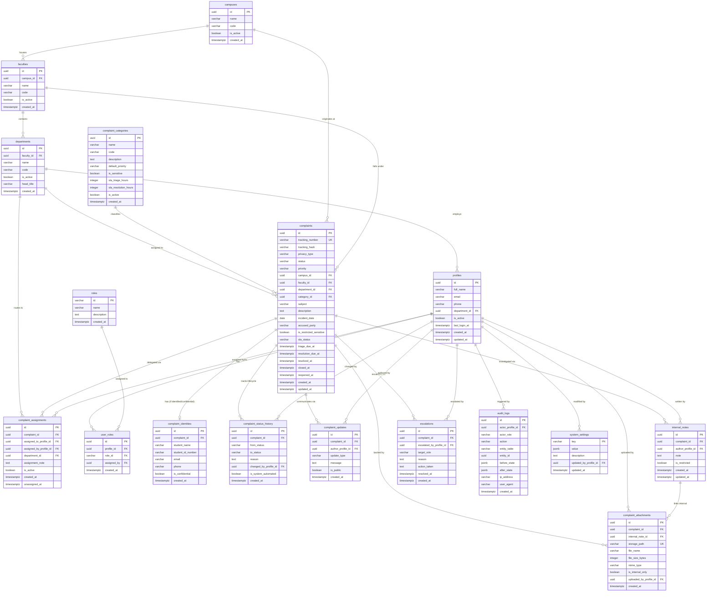

# Entity Relationship Diagram (ERD)

**Product Name:** Unity Student Support  
**Document Version:** 1.0.0  
**Target RDBMS:** PostgreSQL 15+ (Supabase)  

---

## 1. Relational Entity Relationship Diagram

---

## 2. Key Architectural Invariants Enforced by Schema

1. **Airgap Invariant:** The table `internal_notes` does not join to `complaint_updates`. Public queries are restricted by RLS to select exclusively from `complaints`, `complaint_updates`, and non-internal rows of `complaint_attachments`.
2. **Identity Decoupling Invariant:** Table `complaints` has zero direct personal student fields. For `ANONYMOUS` complaints, no corresponding row in `complaint_identities` exists. For `CONFIDENTIAL` complaints, RLS policies prevent Department Handlers from reading `complaint_identities`.
3. **Audit Immutability Invariant:** A PostgreSQL trigger blocks `UPDATE` or `DELETE` statements on `audit_logs` and `complaint_status_history`.

