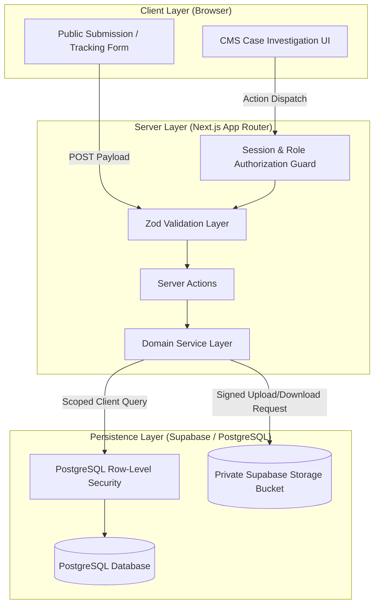
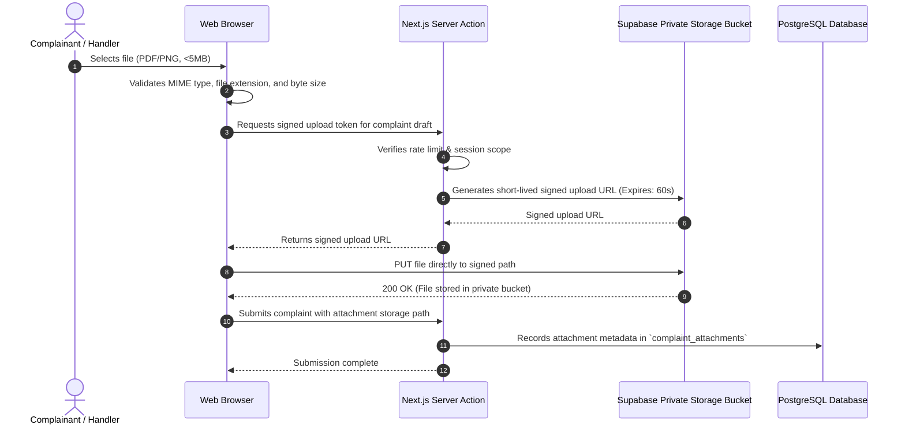

# System Architecture Specification

**Product Name:** Unity Student Support  
**Document Version:** 1.0.0  
**Status:** Approved Technical Architecture Baseline  
**Sponsor:** Melhek Technologies & Unity University  

---

## 1. Architectural Philosophy & Core Principles

The technical architecture of **Unity Student Support** is built on six foundational principles:

1. **Zero-Trust Identity Partitioning:** Public students interact with the platform without persistent identity accounts. Personally Identifiable Information (PII) for confidential complaints is segregated into an isolated relational table (`complaint_identities`) governed by strict Row Level Security (RLS) policies and accessed only by authorized triage and senior escalation officers.
2. **The Airgap Doctrine (Public vs. Internal Information):** Internal investigative findings, deliberation notes, witness statements, and staff annotations are physically persisted in a distinct table (`internal_notes`) that is unreachable by public tracking endpoints and barred by database-level security policies.
3. **Cryptographic Bearer Credential Model:** Raw database primary keys (`UUIDv4`) are never exposed publicly or used as authorization tokens. Public tracking relies on a two-factor bearer credential: an institutional Tracking Reference (`UU-YYYY-XXXXX`) paired with a high-entropy secret Passcode (`xxxx-xxxx-xxxx-xxxx`). The plain passcode is never persisted; only its salted cryptographic hash is stored.
4. **Defense-in-Depth Enforcement:** Authorization is enforced at three distinct layers:
   - **Edge/Network Layer:** Rate limiting, IP reputation, and header sanitization.
   - **Application/Server Layer:** Next.js Server Actions and Route Handlers enforcing schema validation (Zod) and programmatic RBAC checks.
   - **Database Layer:** PostgreSQL Row-Level Security (RLS) enforcing tenancy, department isolation, and role permissions directly inside the query planner.
5. **Decoupled Domain Service Architecture:** Presentation components (React Server Components, client forms) contain zero business logic. All business rules, status mutations, and conflict checks execute within isolated domain service modules (`/src/lib/services/*`).
6. **Immutable Accountability:** Every privileged mutation, assignment alteration, status change, and PII access event emits an immutable audit event to `audit_logs` protected by PostgreSQL write-once constraints.

---

## 2. Next.js Application Topology

The application uses **Next.js 14+ App Router** with TypeScript strict mode. The codebase is organized into distinct route groups that cleanly separate public student workflows from the authenticated administrative CMS.

```
src/
├── app/
│   ├── (public)/                        # Public Student Surface (Account-Free)
│   │   ├── layout.tsx                   # Public layout (institutional header, student footer)
│   │   ├── page.tsx                     # Landing page & platform mission overview
│   │   ├── portal/
│   │   │   ├── submit/
│   │   │   │   ├── page.tsx             # Multi-step intake wizard orchestrator
│   │   │   │   └── success/page.tsx     # Credential issuance & receipt download
│   │   │   ├── track/
│   │   │   │   ├── page.tsx             # Tracking lookup form (Ref + Passcode)
│   │   │   │   └── [reference]/page.tsx # Public tracking status & clarification portal
│   │   │   └── help/page.tsx            # Student rights, FAQs, whistleblower guidance
│   ├── (admin)/                         # Protected Administrative CMS
│   │   ├── layout.tsx                   # CMS shell (sidebar, navigation, user menu)
│   │   ├── login/page.tsx               # Staff authentication (Supabase Auth)
│   │   ├── reset-password/page.tsx      # Staff credential recovery
│   │   ├── dashboard/page.tsx           # Operational overview, triage alerts, SLA metrics
│   │   ├── complaints/
│   │   │   ├── page.tsx                 # Master complaint queue (tabbed: New, Assigned, Escalated)
│   │   │   └── [id]/page.tsx            # Comprehensive case investigation workspace
│   │   ├── reports/page.tsx             # Aggregate reporting & analytics (Auditor / Leadership)
│   │   ├── team/page.tsx                # Staff roster, role assignment (System Admin only)
│   │   └── settings/page.tsx            # Taxonomy, SLA configuration (System Admin only)
│   └── api/                             # Minimal Edge & Webhook Endpoints
│       ├── health/route.ts              # Uptime and database health probe
│       ├── storage/sign/route.ts        # Short-lived signed URL generator for attachments
│       └── cron/sla-monitor/route.ts    # Scheduled background SLA breach monitor
├── components/                          # UI Component Library
│   ├── ui/                              # shadcn/ui primitives (button, dialog, card, badge, etc.)
│   ├── public/                          # Public intake wizard components & tracking timeline
│   └── admin/                           # Case workspace, assignment modals, note editors
├── lib/                                 # Core Engineering Layer
│   ├── auth/                            # Session verification, role guards, tracking token auth
│   ├── db/                              # Supabase clients (browser, server, service-role admin)
│   ├── services/                        # Decoupled Domain Services:
│   │   ├── complaint.service.ts         # Submission, triage, assignment, resolution
│   │   ├── tracking.service.ts          # Credential generation, hashing, verification
│   │   ├── notes.service.ts             # Air-gapped internal notes handling
│   │   ├── response.service.ts          # Public student response authoring & approval
│   │   ├── escalation.service.ts        # Escalation routing & sensitive case isolation
│   │   └── audit.service.ts             # Immutable audit log emitter
│   ├── validations/                     # Zod input schemas for all server actions & forms
│   ├── utils/                           # Formatting, crypto utilities, rate limit helpers
│   └── types/                           # Strict TypeScript interfaces, enums, database definitions
```

---

## 3. Server-Side Execution & Service Boundaries

Client components (`"use client"`) are strictly restricted to capturing user input, managing ephemeral UI state (e.g., active form step, modal toggles), and rendering data. All mutations and sensitive queries execute through **Next.js Server Actions** or protected Server Components.



### 3.1 Server Action Execution Flow
Every administrative and public server action follows a rigid pipeline:
1. **Context & Rate Check:** Verify client IP rate-limiting budget (e.g., via Redis or token bucket memory store).
2. **Authentication / Token Check:**
   - For administrative actions: Retrieve Supabase Auth session via cookies, verify user profile, ensure `is_active = true`.
   - For public tracking actions: Validate tracking session JWT or verify reference + passcode credentials.
3. **Input Validation:** Parse all incoming parameters through a strict Zod schema with `.strict()`, rejecting unpermitted fields.
4. **Authorization & Conflict-of-Interest Guard:** Verify the user role possesses the required action permission and does not have an active conflict of interest on the target case.
5. **Domain Execution:** Invoke domain service method wrapped in a PostgreSQL transaction when multi-table consistency is required.
6. **Audit Emission:** Append structured audit event to `audit_logs` prior to committing.
7. **Safe Response Formatting:** Return sanitized DTOs (Data Transfer Objects), ensuring zero internal database metadata or PII is leaked.

---

## 4. Supabase & Database Integration Architecture

The platform uses three distinct Supabase client configurations tailored to execution context:

| Client Type | Instantiation Method | Execution Context | Privileges & Key Used | Security Guarantees |
| :--- | :--- | :--- | :--- | :--- |
| **Browser Client** | `createBrowserClient()` | Browser client components | `NEXT_PUBLIC_SUPABASE_ANON_KEY` | Strictly constrained by PostgreSQL RLS. Cannot query private tables. |
| **Server Client (SSR)** | `createServerClient()` | Next.js Server Components & Server Actions | `NEXT_PUBLIC_SUPABASE_ANON_KEY` + User Session Cookies | Operates as authenticated staff or anon; subject to PostgreSQL RLS based on `auth.uid()`. |
| **Admin Service Client**| Direct server factory `createAdminClient()` | Isolated Server-Side Services only (e.g., Auth creation, System Audit write) | `SUPABASE_SERVICE_ROLE_KEY` (Server environment only) | Bypasses RLS. **Strictly forbidden** in general route handlers. Used exclusively for system audit insertion and account provisioning. |

---

## 5. File Upload & Retrieval Architecture

Supporting documents (evidence, receipts, vouchers) present high security and confidentiality risks.



### 5.1 Storage Security Parameters
- **Bucket Configuration:** Private bucket named `complaint-attachments` with public read access disabled (`public = false`).
- **File Storage Pathing:** Structured as `complaints/{complaint_id}/{uuid}-{sanitized_filename}`. Unpredictable UUIDs prevent enumeration.
- **Retrieval Mechanism:** Direct file downloads are prohibited. Complainants and authorized staff must request a short-lived signed download URL (valid for a maximum of 15 minutes) issued only after verifying case access permissions.
- **File Validation Rules:**
  - Allowed MIME types: `application/pdf`, `image/jpeg`, `image/png`, `image/webp`.
  - Content-Type verification: Server checks magic bytes (file signature) if processed server-side.
  - Maximum size: 5 MB per file; maximum 3 files per complaint.

---

## 6. Public Tracking Bearer Credential Architecture

Public tracking must be completely decoupled from internal database IDs.

### 6.1 Credential Components
1. **Tracking Reference Number (`tracking_number`):**
   - Format: `UU-YYYY-XXXXX` (e.g., `UU-2026-89412`).
   - `UU` = Institutional prefix (Unity University).
   - `YYYY` = Gregorian calendar year of submission.
   - `XXXXX` = 5-character uppercase alphanumeric string generated from a cryptographically secure pseudorandom number generator (CSPRNG), excluding ambiguous characters (`0`, `O`, `1`, `I`, `L`).
   - Stored in cleartext in `complaints.tracking_number` with a unique index.
2. **Secret Tracking Passcode (`tracking_passcode`):**
   - Generated using Node.js `crypto.randomBytes(12)` formatted as a 16-character string: `xxxx-xxxx-xxxx-xxxx` (e.g., `m9w2-8vk4-7pq1-x3z8`).
   - Total entropy: ~70 bits, providing robust resistance against online and offline brute-force attacks.
   - **Storage Rule:** The cleartext passcode is displayed to the user **once** upon submission and never stored. The server hashes the passcode using **Argon2id** (or bcrypt with work factor 12) with a unique salt and stores the result in `complaints.tracking_hash`.

### 6.2 Verification & Session Issuance
When a student tracks a complaint via `/portal/track`:
1. System rate-limits the client IP (max 5 failed lookups per 15-minute window).
2. Server fetches the single row matching `tracking_number`.
3. Server verifies the submitted passcode against `tracking_hash`.
4. If valid, server generates an encrypted, short-lived **Tracking Session Token** (JWT, HMAC-SHA256, expiration: 30 minutes) stored in a secure, `HttpOnly`, `SameSite=Lax` session cookie.
5. The token payload contains `{ complaintId, trackingNumber, exp }`. All subsequent requests to `/portal/track/[reference]` authenticate against this verified token.

---

## 7. Background Processing & Scheduled Tasks

The platform requires asynchronous maintenance tasks executed via scheduled edge route handlers (`/api/cron/*`) protected by an authorization bearer secret (`CRON_SECRET`):

1. **SLA Breach Monitor (`/api/cron/sla-monitor`):**
   - Runs every 60 minutes during business hours.
   - Scans active complaints where `status` is `NEW`, `UNDER_REVIEW`, `ASSIGNED`, or `IN_PROGRESS`.
   - Computes elapsed business hours against configured SLA thresholds.
   - Updates `sla_status` (`NORMAL`, `APPROACHING_BREACH`, `BREACHED`).
   - Triggers internal escalation notifications for severely breached cases.
2. **Grace-Period Auto-Closure (`/api/cron/auto-close`):**
   - Runs daily at 00:00 UTC.
   - Identifies complaints in `RESOLVED` status where `resolved_at` exceeds the configured grace period (Default: 5 business days) with no active reopening requests.
   - Transitions status to `CLOSED` and logs system closure in `audit_logs`.
3. **Orphaned Attachment Cleanup (`/api/cron/clean-drafts`):**
   - Runs weekly to purge unreferenced uploaded files in the storage bucket that were not linked to a finalized complaint record within 24 hours.

---

## 8. Observability, Logging & Error Handling

- **Structured Logging:** Application logs output structured JSON including: `timestamp`, `level`, `trace_id`, `actor_role`, `action`, `endpoint`, and `status_code`.
- **Zero PII in Logs:** Logger middleware intercepts and scrubs sensitive fields (`student_name`, `email`, `phone`, `student_id`, `tracking_passcode`, `narrative`).
- **Standardized Error Envelope:** All server actions and API endpoints return a typed response structure:
  ```typescript
  export type ActionResult<T> = 
    | { success: true; data: T; message?: string }
    | { success: false; error: string; code?: string; fieldErrors?: Record<string, string[]> };
  ```
- **Error Boundaries:** Next.js `error.tsx` boundaries catch runtime exceptions gracefully, presenting institutional error cards without revealing stack traces.

