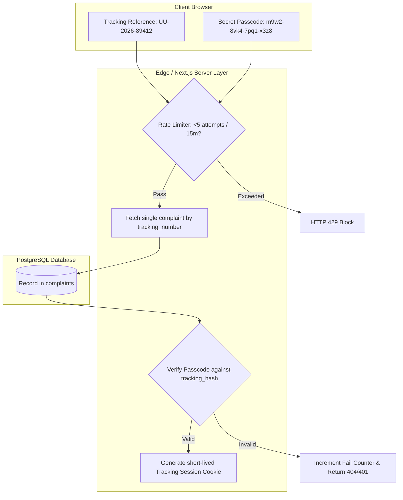

# Security Model & Controls Specification

**Product Name:** Unity Student Support  
**Document Version:** 1.0.0  
**Status:** Approved Security Architecture Baseline  

---

## 1. Security Architecture Principles & Scope

The security architecture of **Unity Student Support** treats all incoming input as untrusted and implements strict defense-in-depth across the web application, API layer, execution runtime, and database storage.

Security is **not** assumed simply because Supabase or PostgreSQL RLS is present; security is achieved through verifiable, testable controls implemented at each tier of the stack.

---

## 2. Staff Authentication & Session Lifecycle

### 2.1 Authentication Provider & Credentials
- Staff authentication is managed via **Supabase Auth** utilizing email and password credentials.
- **Password Complexity:** Minimum 12 characters, requiring uppercase, lowercase, numbers, and symbols. Enforced via client validation and Supabase Auth configuration.
- **Brute Force Protection:** Supabase Auth rate limits authentication attempts (maximum 5 failed attempts per IP/account before temporary lockout).
- **Session Tokens:** Auth tokens are stored in `HttpOnly`, `Secure`, `SameSite=Lax` cookies managed via `@supabase/ssr`. Tokens are never exposed to browser JavaScript (mitigating Cross-Site Scripting / XSS session hijacking).
- **Account Deactivation:** Every server request cross-references `profiles.is_active`. If an administrator deactivates a staff account, all active sessions are invalidated immediately on the next server request.

---

## 3. Row Level Security (RLS) Policy Architecture

All operational tables have PostgreSQL Row Level Security enabled (`ALTER TABLE ... ENABLE ROW LEVEL SECURITY;`). The default behavior for all tables without matching policies is **DENY ALL**.

### 3.1 RLS Policies by Entity

#### Entity: `complaints`
**Live MVP rules (source of truth: migrations `0007` and `0013`):**

- Anonymous/public clients have no direct `SELECT` policy on complaints. Tracking is mediated by the server after reference/passcode verification.
- Current live `0007` policies allow active escalation officers to read all complaints and grant other roles access to some case-related tables. The single-receiver boundary is not complete yet.
- Migration `0013` adds the following all-complaint read policy for the active Student Affairs officer:

```sql
CREATE POLICY complaints_student_affairs_all_read
  ON public.complaints
  FOR SELECT
  TO authenticated
  USING (
    public.is_active_staff()
    AND public.has_role('student_affairs_admin')
  );
```

PostgreSQL combines permissive SELECT policies. Migration `0014_student_affairs_only_receiver.sql` removes legacy staff case-data access and limits case handling to the active `student_affairs_admin` role. A live catalog check on 2026-11-14 confirmed the migration record, row-level security on all nine case tables, one active Student Affairs account, Student Affairs-only complaint read/update policies, and no anonymous/public complaint read policy. Complaints involving the Student Dean need an out-of-platform university referral process.

#### Entity: `complaint_identities` (PII Decoupling & Confidentiality)
```sql
-- 1. Identified Complaints: Visible to assigned Department Handlers, Admins, and Escalation Officers
CREATE POLICY "View PII for Identified Complaints"
ON public.complaint_identities FOR SELECT
TO authenticated
USING (
  is_confidential = false
  AND (
    EXISTS (SELECT 1 FROM auth.current_staff_roles() r WHERE r.role_id IN ('student_affairs_admin', 'escalation_officer'))
    OR (
      EXISTS (SELECT 1 FROM auth.current_staff_roles() r WHERE r.role_id = 'department_handler')
      AND complaint_id IN (
        SELECT id FROM public.complaints 
        WHERE department_id = (SELECT department_id FROM public.profiles WHERE id = auth.uid())
      )
    )
  )
);

-- 2. Confidential Complaints: Visible ONLY to Student Affairs Admin and Escalation Officers
CREATE POLICY "View PII for Confidential Complaints strictly restricted"
ON public.complaint_identities FOR SELECT
TO authenticated
USING (
  is_confidential = true
  AND EXISTS (SELECT 1 FROM auth.current_staff_roles() r WHERE r.role_id IN ('student_affairs_admin', 'escalation_officer'))
);
```

#### Entity: `internal_notes` (Airgap Doctrine)
```sql
-- Deny public anon role entirely
-- Allow authenticated staff based on department or escalation role
CREATE POLICY "Staff can view internal notes"
ON public.internal_notes FOR SELECT
TO authenticated
USING (
  EXISTS (SELECT 1 FROM auth.current_staff_roles() r WHERE r.role_id IN ('student_affairs_admin', 'escalation_officer', 'auditor'))
  OR (
    EXISTS (SELECT 1 FROM auth.current_staff_roles() r WHERE r.role_id = 'department_handler')
    AND complaint_id IN (
      SELECT id FROM public.complaints 
      WHERE department_id = (SELECT department_id FROM public.profiles WHERE id = auth.uid())
    )
    AND is_restricted = false
  )
);
```

---

## 4. Public Tracking Bearer Credential Security

A complaint is **never** accessible merely because someone knows or guesses an internal database UUID. Access requires a two-factor bearer credential:



### 4.1 Generation Method & Entropy
1. **Tracking Reference:** Format `UU-YYYY-XXXXX`. `XXXXX` is generated using `crypto.randomInt(0, 36^5)` mapped to base-36 characters excluding ambiguous glyphs (`0`, `O`, `1`, `I`, `L`). Collision probability is managed via database unique constraint.
2. **Secret Passcode:** Generated via `crypto.randomBytes(12)` yielding 96 bits of cryptographic pseudo-randomness, formatted as `xxxx-xxxx-xxxx-xxxx`.
3. **Hashing & Storage:**
   - Cleartext passcode is output **once** to the complainant and never stored.
   - The server hashes the passcode using **Argon2id** (memory cost: 64MB, time cost: 3 iterations, parallelism: 1) or bcrypt (cost factor: 12).
   - Only the resulting hash is committed to `complaints.tracking_hash`.

### 4.2 Brute-Force & Enumeration Mitigation
- Tracking lookups execute against a sliding-window rate limiter per client IP.
- After 5 failed lookups within a 15-minute window, the endpoint returns HTTP 429 and blocks further attempts for 15 minutes.
- Error responses are strictly uniform: *"No active complaint found matching these credentials"* is returned for both non-existent references and invalid passcodes, preventing reference enumeration.

---

## 5. Input Validation, CSRF & Content Security

### 5.1 Server-Side Validation (Zod)
Every server action validates all input with `.strict()` Zod schemas. Any undeclared parameters (potential mass-assignment exploits) trigger validation rejections.

```typescript
// Example: Strict submission schema
export const CreateComplaintSchema = z.object({
  submissionType: z.enum(['IDENTIFIED', 'CONFIDENTIAL', 'ANONYMOUS']),
  campusId: z.string().uuid(),
  facultyId: z.string().uuid(),
  departmentId: z.string().uuid(),
  categoryId: z.string().uuid(),
  subject: z.string().min(5).max(150).trim(),
  description: z.string().min(20).max(5000).trim(),
  incidentDate: z.string().regex(/^\d{4}-\d{2}-\d{2}$/),
  accusedParty: z.string().max(150).trim().optional(),
  // Student identity details (conditional)
  studentName: z.string().min(2).max(100).optional(),
  studentIdNumber: z.string().regex(/^[A-Za-z0-9/\-]{5,20}$/).optional(),
  email: z.string().email().optional(),
  phone: z.string().regex(/^(\+251|0)[79][0-9]{8}$/).optional(),
}).strict();
```

### 5.2 Cross-Site Request Forgery (CSRF)
- Next.js Server Actions feature built-in CSRF protection by validating the `Host` and `Origin` request headers against trusted hostnames.
- Administrative session cookies employ `SameSite=Lax` and `Secure` attributes, preventing third-party cross-site request delivery.

---

## 6. Secure Attachment Handling & Storage Isolation

1. **Private Buckets:** The storage bucket `complaint-attachments` has `public = false`. Direct HTTP requests to raw object URLs receive 403 Forbidden.
2. **Pre-Signed URLs:** File uploads and downloads require temporary pre-signed URLs generated server-side after verifying authorization. Pre-signed upload URLs expire in 60 seconds; pre-signed download URLs expire in 15 minutes.
3. **MIME & Content-Type Enforcement:**
   - Allowed MIME types: `application/pdf`, `image/jpeg`, `image/png`, `image/webp`.
   - File extensions are sanitized. Script and executable extensions (`.html`, `.svg`, `.exe`, `.js`, `.sh`, `.php`) are strictly blocked.
4. **Storage Path Partitioning:** Files are organized as `complaints/{complaint_id}/{uuid}-{filename}`. Guessing storage paths is computationally infeasible.

---

## 7. Audit Logging & Non-Repudiation

All state mutations and sensitive read operations write an immutable record to `audit_logs`.

### 7.1 Database Immutability Trigger
To ensure non-repudiation, a PostgreSQL trigger explicitly prevents `UPDATE` or `DELETE` operations on the audit log table:

```sql
CREATE OR REPLACE FUNCTION prevent_audit_modification()
RETURNS TRIGGER AS $$
BEGIN
  RAISE EXCEPTION 'Audit logs are strictly append-only and cannot be updated or deleted.';
END;
$$ LANGUAGE plpgsql;

CREATE TRIGGER audit_logs_immutable_trigger
BEFORE UPDATE OR DELETE ON public.audit_logs
FOR EACH ROW EXECUTE FUNCTION prevent_audit_modification();
```

---

## 8. Secrets Management & Environment Security

- **Client Exposure Prevention:** Only variables prefixed with `NEXT_PUBLIC_` are bundled into the browser client. `SUPABASE_SERVICE_ROLE_KEY`, database pooler passwords, and session secrets are strictly confined to the Node.js server environment.
- **Verification Rule:** Continuous integration (CI) lint checks scan codebase commits for any un-prefixed credential references.

---

## 9. Backup, Disaster Recovery & High Availability

1. **Automated Point-in-Time Recovery (PITR):** PostgreSQL database utilizes continuous WAL archiving with 7-day point-in-time recovery for disaster restoration.
2. **Daily Snapshots:** Full automated daily snapshots with 30-day retention.
3. **Storage Replication:** Object storage buckets are multi-zone redundant.

